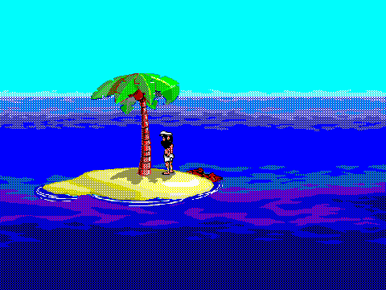
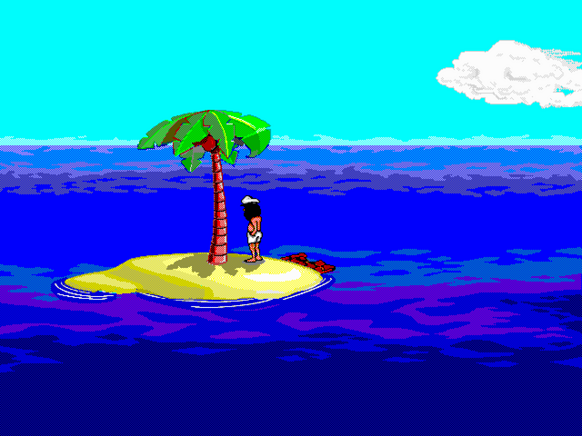
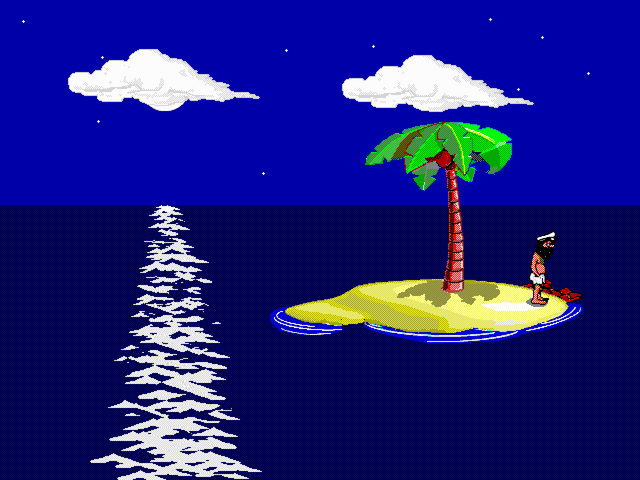

# Johnny Castaway for macOS

The 1992 Sierra / Dynamix screen saver, back as a native macOS screen saver.
Johnny is still stuck on his island, still building rafts that sink, still
getting mocked by the seagull, and still occasionally visited by mermaids.



Daytime and night-time, as rendered by this build:

| | |
|---|---|
|  |  |

The original was a 16-bit Windows 3.1 program (`SCRANTIC.SCR`) and cannot run
on any modern Mac. This project uses **Johnny Reborn**, an open-source C
engine that interprets the original animation scripts and artwork, wrapped in
a `ScreenSaverView` so it works like any other `.saver` bundle: it shows up in
System Settings, has a Settings sheet, runs on every display, and stops the
moment you touch the mouse or keyboard.

## Install

You need macOS 11 or newer and the Xcode Command Line Tools (a one-time
install; the command below prompts for it if it is missing).

```sh
xcode-select --install          # only if you do not have the tools yet
git clone https://github.com/newideasunlimited/johnny-castaway.git
cd johnny-castaway
make install
```

`make install` does three things:

1. **Downloads the game data** (`data/scrantic_data.zip`, about 6 MB) and
   checks its SHA-256. This is the original `RESOURCE.MAP` / `RESOURCE.001`
   and sound samples, plus the optional upscaled artwork. See
   [Where the data comes from](#where-the-data-comes-from).
2. **Builds `build/JohnnyCastaway.saver`**, a universal (Apple silicon +
   Intel) bundle, with `clang` straight from the Command Line Tools. No
   Xcode project, no Homebrew, no package manager.
3. **Copies it to `~/Library/Screen Savers/`** and nudges System Settings to
   notice it.

Then open **System Settings > Screen Saver**, scroll to the **Other** section
and pick **Johnny Castaway**. If System Settings was already open, quit and
reopen it so it rescans the folder.

### Settings

Click **Options…** under the preview:

- **Artwork**: *HD* (the original 16-colour art, cleanly upscaled 2x) or
  *Cartoon*, a redrawn preview style from the engine project that falls
  back to HD for scenes it does not cover yet.
- **Time of day**: follow the clock (night backdrop from 21:00 to 05:59, as
  the original did), or force day or night.
- **Scaling**: the original is 4:3 and your screen is not. The default
  fills the screen by mirroring the ocean and sky into the space at the
  sides, so nothing is cut off and there are no black bars. The other
  choices crop the top and bottom, stretch, letterbox, or letterbox at a
  whole-number pixel scale for the sharpest picture.
- **Play sound effects**: the original samples, through Core Audio. The
  System Settings preview is always silent.

Johnny's story advances a "day" per calendar day, as in the original; that
progress is saved by the engine in its own small config file.

### Try it in a window first

```sh
make cli
./build/jc_reborn window hotkeys
```

This builds the engine with its upstream Cocoa window backend. `Esc` quits,
`Space` pauses, `M` toggles max speed, `Alt+Return` goes full screen.
`./build/jc_reborn help` lists the rest.

### Prebuilt bundle from CI

Every push builds the bundle on a macOS GitHub Actions runner and attaches
`JohnnyCastaway.saver.zip` as a workflow artifact. Because that file was
downloaded from the internet, macOS quarantines it; after unzipping, clear
the flag before installing or System Settings will refuse to load it:

```sh
xattr -dr com.apple.quarantine JohnnyCastaway.saver
mv JohnnyCastaway.saver ~/Library/Screen\ Savers/
```

Building locally with `make install` avoids this entirely.

## How it works

```
saver/JohnnyCastawayView.m   ScreenSaverView: starts/stops the engine thread,
                             draws the latest frame, owns the Settings sheet
saver/platform_saver.c       the engine's platform backend for this host:
                             offscreen surface -> front buffer, AudioQueue
                             sound, no window, no input
engine/                      Johnny Reborn (vendored, GPL-3.0); see
                             engine/UPSTREAM.md for the exact commit and
                             the handful of changes made for embedding
tools/platform_headless.c    a backend with no display, used by CI and for
                             rendering frames on any OS (the images above
                             were made with it on Linux)
scripts/fetch-data.sh        downloads and verifies scrantic_data.zip
```

When the saver is dismissed the sound is muted at once, the engine is asked
to quit, and the host process exits. The last step matters on macOS 14 and
later, where the system's `legacyScreenSaver` host is not reliably told to
stop and would otherwise keep the engine (and its sound effects) running in
the background; the system's own "screen saver did stop" notification is
used as the trigger, with a hidden-window check as a fallback.

The engine is a single-instance C program, so one engine runs per process
and every `ScreenSaverView` (one per display, plus the System Settings
preview) draws the same frame. The engine renders at 1280x960 (2x the
original 640x480) into a software surface; each presented frame is copied
under a lock into a front buffer that the view blits with Core Graphics,
letterboxed and with interpolation turned off so the pixel art stays sharp.

## Where the data comes from

Johnny Castaway was developed by Dynamix and published by Sierra On-Line in
1992. The rights passed to Activision and are now believed to sit with
Microsoft. It has not been sold since 2008 and no one has ever released it
as freeware, so the artwork, scripts and sounds remain copyrighted
abandonware. This repository therefore does **not** contain them.

`scripts/fetch-data.sh` downloads `scrantic_data.zip` from the Johnny Reborn
HD project's repository on GitHub (pinned to one commit and verified by
checksum). That archive holds the data from the widely circulated
*v1.01 (Int. 1.4.93)* floppy release. The same floppy image is on the
[Internet Archive](https://archive.org/details/screen-antics-johnny-castaway-16-color-v1.01-int.-1.4.93-win3.1-1.44m).
If you have your own copy of the original files and would rather use that,
drop a zip with the same layout (`data/RESOURCE.MAP`, `data/RESOURCE.001`,
`data/sound*.wav`) at `data/scrantic_data.zip` before running `make`; the
script leaves an existing file alone.

Use of the original game data is your own responsibility.

## Development

```sh
make headless                       # builds build/jc_headless on macOS or Linux
JC_REBORN_DATA=$PWD/data/scrantic_data.zip \
JC_HEADLESS_DIR=/tmp/frames JC_HEADLESS_EVERY=4 \
./build/jc_headless maxspeed nosound seed 7 day frames 900
```

Frames land in `/tmp/frames` as PPM files, one every 4 presented frames;
`seed` makes the run reproducible and `day` / `night` force the backdrop.
`make clean` removes `build/`.

## Credits

- **Johnny Castaway**: Dynamix, Inc. / Sierra On-Line, 1992. Designed by
  Jeff Tunnell and team.
- **Johnny Reborn** engine: Jérémie Guillaume (jc_reborn) and the
  [johnny-castaway-rebornHD](https://github.com/bigfnj/johnny-castaway-rebornHD)
  contributors, building on Hans Milling's reverse engineering of the
  resource format in
  [Johnny-Castaway-Open-Source](https://github.com/nivs1978/Johnny-Castaway-Open-Source).
- The [ScummVM DGDS engine](https://github.com/scummvm/scummvm/tree/master/engines/dgds)
  team, whose work on Dynamix's script formats informed all of the above.

## License

The engine and this wrapper are GPL-3.0-or-later; see [LICENSE](LICENSE).
The Johnny Castaway name, artwork, scripts and sounds are not covered by that
license and belong to their rights holder.
